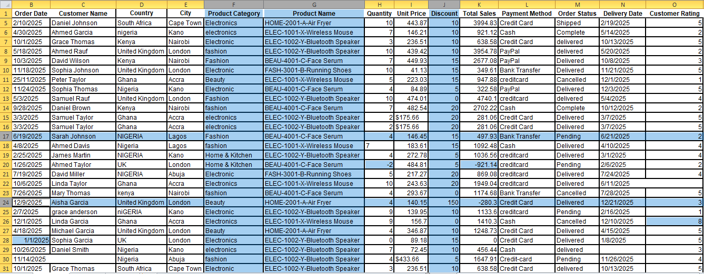
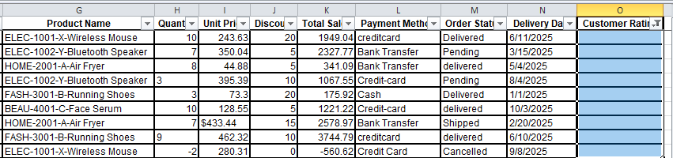
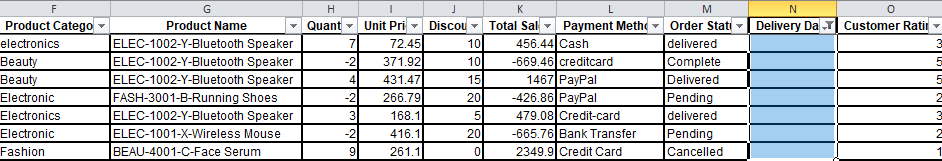
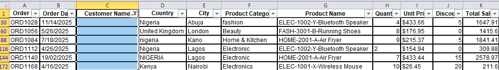

# Cleaning Modsone E-commerce store dataset

### INTRODUCTION 
Cleaning Modson store messy e-commerce orders dataset in Excel, checking it for errors, and turning it into sales insights.

### Business question: 
Which products, countries and payment methods drive revenue, and how reliable is the data behind those numbers?

Download the workbook [Here!](E_COMMERCE%20DATASET.xlsx)

### Excel Skills used:
- Vlookup()
- IF()
- LEFT(), FIND()

### Ecommerce Dataset
The dataset used for this project contains real-world e-commerce information which includes detailed product information on:
Order ID, Order Date, Customer Name, Country, City, Product Category, Product Name, Quantity, Unit Price, Discount, Total Sales, 
Payment Method, Order Status, Delivery Date, Customer Rating

## 1. Data Cleaning
### Duplicate Values:
Using the Order ID column, Six duplicate values was identified and cleaned.


### Inconsistent values:
There are inconsistent data in 
- Country 
- Product category 
- Payment Method 
- Order Status


### Data Quality Issues
- Discount stored as 20 instead of 20%
- Discount exceeds 100
- Dates stored as text
- Category label did not match the product code
- Day and month swapped	in Order Date column
- Customer rating greater than 5
- Negative number in quantity
- Order Date should be greater than or equal to Delivery Date, but in some cases, they are not so.

   


### Missing values
- Missing rating
- Missing delivery date
- Missing customer name

  

  

  


  ## Formulas and Functions
  The functions and formulas used are found in the [Cleaned](E_COMMERCE%20DATASET.xlsx) Sheet of the excel workbook
  - I used this function to extract the first four product code from Product Name column
  ```
  =LEFT([@[Product Name]],FIND("-",[@[Product Name]])-1)
  ```

  - I use the function below to return the correct Cleaned Product Category for each extracted four letter Product code
    
    ```
    =VLOOKUP(I140,REPORT!$B$1:$C$4,2,FALSE)
         ```
   - The function below compares the Original Product Category with the Cleaned Product Category column
     ```
      =IF(F140=J140,"Match","Mismatch")
     ```
  
   - The function below checks whether the Order Date is less than or equal to the Delivery Date (Which is logically right)
     ```
     =IF(B2<=R2,"YES","NO")
        ```


