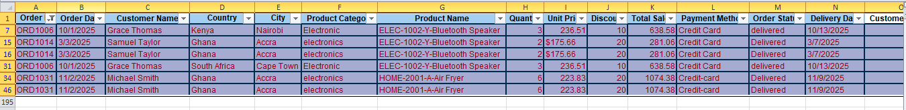
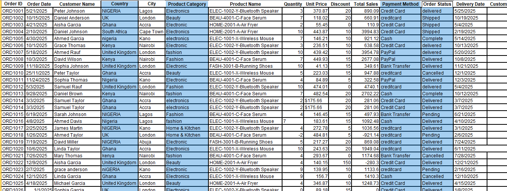

# Modson store Data Cleaning (Excel)
Cleaning Modsone E-commerce store dataset

### INTRODUCTION 
Cleaning Modson store messy e-commerce orders dataset in Excel, checking it for errors, and turning it into sales insights.

### Business question: 
Which products, countries and payment methods drive revenue, and how reliable is the data behind those numbers?

Download the workbook [Here!](E_COMMERCE%20DATASET.xlsl)

### Excel Skills used:
- Vlookup
- IF, AND, OR
- COUNTIF, COUNTIFS
- SUMIFS, AVERAGEIF

### Ecommerce Dataset
The dataset used for this project contains real-world e-commerce information which includes detailed product information on:
Order ID, Order Date, Customer Name, Country, City, Product Category, Product Name, Quantity, Unit Price, Discount, Total Sales, 
Payment Method, Order Status, Delivery Date, Customer Rating

## 1. Data Cleaning
### Duplicate Values:
Using the Order ID column, Six duplicate values was identified and cleaned.

### Inconsistent values:
There are inconsistent data in Country column, Product category, Payment Method, and Order Status

